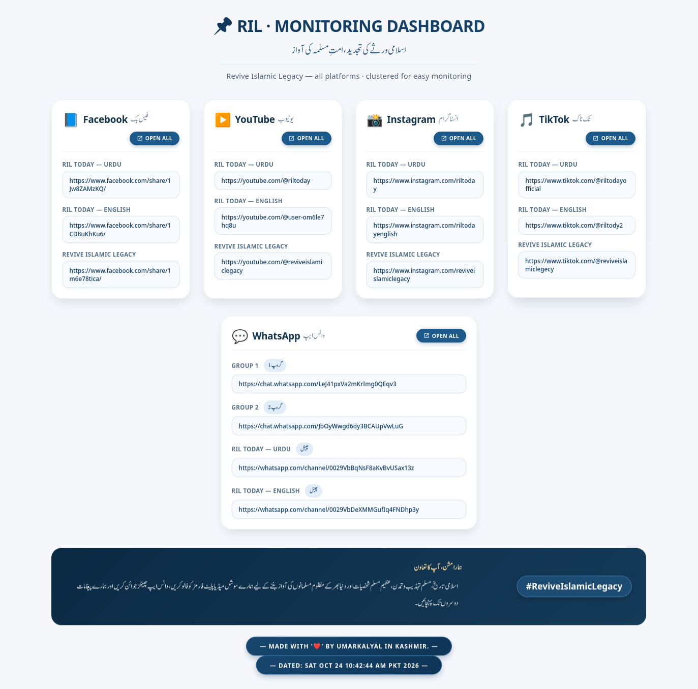

# RIL Handles Monitorer

A single-page HTML dashboard for monitoring all **Revive Islamic Legacy (RIL)** social media handles from one place. Built for the RIL Team to keep track of every platform and channel in an organized, clustered view.



## Features

- **Clustered links** – Facebook, YouTube, Instagram, TikTok, and WhatsApp grouped into separate cards
- **Open All button** – One click opens every link of a platform in new tabs
- **Bilingual UI** – English labels with Urdu translations
- **Urdu typography** – Rendered with Jameel Noori Nastaleeq font
- **Responsive design** – Works on desktop, tablet, and mobile
- **No dependencies** – Pure HTML, CSS, and vanilla JavaScript

 
## Usage

- Open the page in any modern browser.
- Click any individual link to open that specific platform page.
- Click the **Open All** button in a card to open every link of that platform at once in new tabs.
- Allow pop-ups for this site so the "Open All" button works smoothly.

## Monitored Handles

### Facebook
- RIL Today — Urdu: https://www.facebook.com/share/1Jw8ZAMzKQ/
- RIL Today — English: https://www.facebook.com/share/1CD8uKhKu6/
- Revive Islamic Legacy: https://www.facebook.com/share/1m6e78tica/

### YouTube
- RIL Today — Urdu: https://youtube.com/@riltoday?si=_kmm-6GzM4apeFnB
- RIL Today — English: https://youtube.com/@user-om6le7hq8u?si=L60_xgmbFMZRwdGI
- Revive Islamic Legacy: https://youtube.com/@reviveislamiclegacy?si=2pgPJOTD5ANysNr_

### Instagram
- RIL Today — Urdu: https://www.instagram.com/riltoday?dlrf=emhhZTJnbW13YWlx
- RIL Today — English: https://www.instagram.com/riltodayenglish?srtk=M3A1ODR2MHpkbzNy
- Revive Islamic Legacy: https://www.instagram.com/reviveislamiclegacy?vrfl=dTRpd2piaHYxa2Vj

### TikTok
- RIL Today — Urdu: https://www.tiktok.com/@riltodayofficial?_r=1&_t=ZS-9AZkgwach05
- RIL Today — English: https://www.tiktok.com/@riltody2?_r=1&_t=ZS-9AZkvlXrtxJ
- Revive Islamic Legacy: https://www.tiktok.com/@reviveislamiclegecy?_r=1&_t=ZS-9AZkcDRWlvQ

### WhatsApp
- Group 1: https://chat.whatsapp.com/LeJ41pxVa2mKrImg0QEqv3?s=cl&p=a&mlu=4&ilr=4
- Group 2: https://chat.whatsapp.com/JbOyWwgd6dy3BCAUpVwLuG?s=cl&p=a&mlu=4&ilr=4
- RIL Today Channel — Urdu: https://whatsapp.com/channel/0029VbBqNsF8aKvBvUSax13z
- RIL Today Channel — English: https://whatsapp.com/channel/0029VbDeXMMGufIq4FNDhp3y

## Customization

To update links, edit the `platformLinks` object inside the `<script>` tag at the bottom of `index.html`:

```js
const platformLinks = {
 facebook: [ "url1", "url2", ... ],
 youtube:  [ "url1", "url2", ... ],
 // ...
};   
